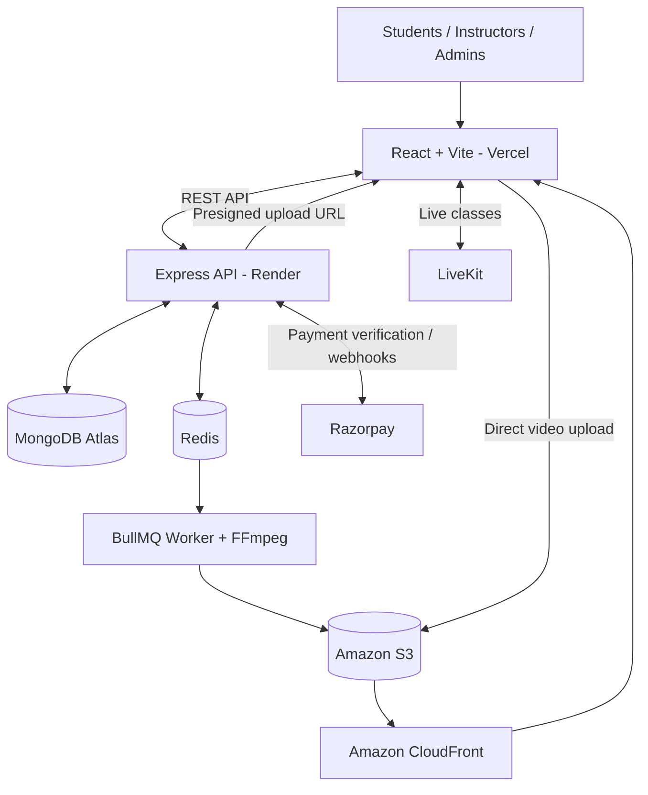

# LearnLive – Learning Management System

LearnLive is a full-stack Learning Management System (LMS) that provides an interactive online learning experience with courses, video lessons, live classes, quizzes, progress tracking, certificates, and online payments.

The platform supports **Students, Instructors, and Administrators**, with dedicated features for learning, course management, and analytics.

## 🌐 Live Application

- **Frontend:** [https://learn-live-peach.vercel.app/](https://learn-live-peach.vercel.app/)
- **Backend API:** [https://learnlive-api-4ho3.onrender.com](https://learnlive-api-4ho3.onrender.com)
- **API Health Check:** [Check Backend Status](https://learnlive-api-4ho3.onrender.com/api/health)

> **Important:** Start or wake up the Render backend before visiting the application. Free or idle Render services may take some time to respond after inactivity. Open the [Backend Health Check](https://learnlive-api-4ho3.onrender.com/api/health) and wait for a successful response before using the frontend.

Expected response:

```json
{
  "ok": true,
  "service": "LearnLive API"
}
```

## ✨ Features

- **Authentication & Authorization:** Secure authentication with role-based access.
- **Course Management:** Create, update, and publish courses.
- **Video Learning:** Video uploads, processing, and streaming.
- **Live Classes:** Real-time virtual classes powered by LiveKit.
- **Quizzes & Assessments:** Automatic grading and score tracking.
- **Learning Progress:** Track completed lessons and quiz performance.
- **Online Payments:** Razorpay integration for course payments.
- **Certificates:** Certificate generation and verification.
- **Instructor Dashboard:** Course analytics, enrollments, and earnings.
- **Admin Features:** Administrative access and platform management.
- **Ownership Isolation:** Instructor course operations are restricted according to permissions.

## 🛠️ Tech Stack

| Category | Technologies |
|---|---|
| Frontend | React, Vite, JavaScript |
| Backend | Node.js, Express.js |
| Database | MongoDB Atlas, Mongoose |
| Authentication | JWT, bcrypt |
| Background Jobs | BullMQ, Redis |
| Video Processing | FFmpeg |
| Storage | AWS S3 |
| Video Delivery | Amazon CloudFront |
| Live Classes | LiveKit |
| Payments | Razorpay |
| Deployment | Vercel, Render |

## 🏗️ Architecture



## 📋 Prerequisites

Install the following before running LearnLive locally:

- [Node.js](https://nodejs.org/) (Node.js 22 LTS or a compatible version supported by the project)
- npm
- [MongoDB Atlas](https://www.mongodb.com/atlas) or a compatible MongoDB instance
- Redis with BullMQ-compatible connection support
- FFmpeg for video processing
- Git

Additional accounts or configuration may be required for AWS S3, CloudFront, LiveKit, and Razorpay.

## 🚀 Getting Started

### 1. Clone the repository

```bash
git clone https://github.com/mithunurs17/LearnLive.git
cd LearnLive
```

### 2. Configure the backend

Navigate to the backend directory:

```bash
cd server
npm install
```

Create a `.env` file in the `server` directory.

Configure the required environment variables:

```env
PORT=4000

MONGODB_URI=your_mongodb_connection_string
JWT_SECRET=your_secure_random_secret_at_least_32_characters

CLIENT_ORIGIN=http://localhost:5173
PUBLIC_CLIENT_URL=http://localhost:5173

ALLOW_ADMIN_SIGNUP=false

REDIS_URL=your_redis_connection_url

AWS_REGION=your_s3_bucket_region
AWS_ACCESS_KEY_ID=your_aws_access_key
AWS_SECRET_ACCESS_KEY=your_aws_secret_key
S3_BUCKET=your_s3_bucket_name
CLOUDFRONT_DOMAIN=your_cloudfront_domain

LIVEKIT_URL=your_livekit_url
LIVEKIT_API_KEY=your_livekit_api_key
LIVEKIT_API_SECRET=your_livekit_api_secret

RAZORPAY_KEY_ID=your_razorpay_key_id
RAZORPAY_KEY_SECRET=your_razorpay_key_secret
RAZORPAY_WEBHOOK_SECRET=your_razorpay_webhook_secret

VIDEO_WORKER_CONCURRENCY=2
EMBED_VIDEO_WORKER=true
```

> **Note:** Use the exact variable names expected by your backend code. This is an environment-variable template; review your existing configuration and `process.env` references before starting. Configure any additional variables required by your implementation.

Never commit your `.env` file, cloud credentials, payment secrets, or JWT secrets to GitHub.

### 3. Start the backend

From the `server` directory:

```bash
npm start
```

If your project uses a different start script, check `server/package.json`.

The API should start at:

```text
http://localhost:4000
```

Health check:

[http://localhost:4000/api/health](http://localhost:4000/api/health)

If Redis, MongoDB, or other required services are not configured correctly, resolve those issues before testing the application.

### 4. Configure and start the frontend

Open a new terminal from the project root:

```bash
cd client
npm install
```

Create a `.env` file in the frontend directory:

```env
VITE_API_URL=http://localhost:4000/api
```

Ensure this matches how the existing frontend API helper constructs its requests.

Start the frontend:

```bash
npm run dev
```

Open:

[http://localhost:5173](http://localhost:5173)

## ☁️ Deployment

### Frontend – Vercel

The frontend is deployed on Vercel.

**Live URL:** [https://learn-live-peach.vercel.app/](https://learn-live-peach.vercel.app/)

Configure the following environment variable in Vercel:

```env
VITE_API_URL=https://learnlive-api-4ho3.onrender.com/api
```

Redeploy the frontend after updating environment variables.

### Backend – Render

The backend API is hosted on Render.

**API URL:** [https://learnlive-api-4ho3.onrender.com](https://learnlive-api-4ho3.onrender.com)

Configure the appropriate production environment variables in Render, including:

```env
CLIENT_ORIGIN=https://learn-live-peach.vercel.app
PUBLIC_CLIENT_URL=https://learn-live-peach.vercel.app
```

Configure MongoDB, Redis, AWS, LiveKit, and Razorpay credentials securely in the Render environment settings.

Ensure the backend listens on the port provided by Render.

### Before using the deployed application

1. Open the [Render API Health Check](https://learnlive-api-4ho3.onrender.com/api/health).
2. Wait until the backend responds successfully.
3. Visit [LearnLive](https://learn-live-peach.vercel.app/).
4. Test course browsing, authentication, and other application features.

## 🔐 Security Notes

- Keep the S3 bucket private.
- Use presigned upload URLs and appropriate access controls.
- Protect private video playback using your configured CloudFront authorization mechanism.
- Never expose AWS, Razorpay, JWT, or LiveKit secrets in frontend variables.
- Enforce authentication and authorization on protected backend endpoints.
- Validate payment signatures and handle webhook events safely.
- Use HTTPS in production.

## 🧪 Testing

Recommended testing areas:

- User registration and login
- Role-based access control
- Course creation and publishing
- Instructor course ownership isolation
- Student enrollment and lesson completion
- Quiz submission and grading
- Video upload, processing, and playback
- Live class access
- Payment verification and webhook handling
- Certificate generation and verification
- API error handling and CORS

## 📁 Project Structure

```text
LearnLive/
├── client/             # React + Vite frontend
├── server/             # Node.js + Express backend
│   └── src/
│       ├── index.js
│       ├── authRoutes.js
│       ├── courseRoutes.js
│       ├── studentRoutes.js
│       ├── liveRoutes.js
│       ├── certificateRoutes.js
│       ├── paymentRoutes.js
│       ├── middleware.js
│       ├── models.js
│       └── workers/
├── README.md
└── .gitignore
```

*The structure above is representative. Your actual repository may contain additional files and directories.*

## 🎯 Project Objective

LearnLive aims to make online education more engaging and accessible by combining structured courses, interactive assessments, live learning sessions, secure video delivery, and integrated payment capabilities in one platform.

## 👨‍💻 Author

**Mithun Urs**

GitHub: [@mithunurs17](https://github.com/mithunurs17)

---

If you find this project useful, consider giving the repository a ⭐.
